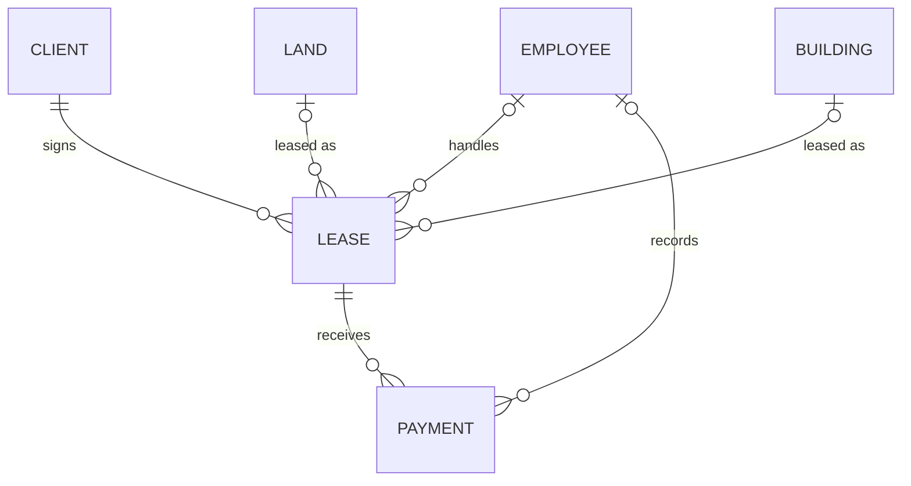

# Estate Desk: Real Estate Management System

A Django class project. Staff register, log in, and manage **clients, employees, land, buildings, leases and payments** from one dashboard. Plain Django templates, SQLite, no JavaScript framework.

> **Current state in one line:** feature-complete for the class demo. All six entities have full add / edit / delete, sign-up and login work, and 11 automated tests pass. Nothing is deployed and there is no role system (see [Known limits](#known-limits)).

## Contents

1. [Run it](#run-it)
2. [What the app does](#what-the-app-does)
3. [Accounts and access rules](#accounts-and-access-rules)
4. [Data model](#data-model)
5. [Project layout](#project-layout)
6. [URLs](#urls)
7. [How the UI works](#how-the-ui-works)
8. [Tests](#tests)
9. [Demo data and the database file](#demo-data-and-the-database-file)
10. [Design tokens and logo](#design-tokens-and-logo)
11. [Status: done, not done, known limits](#status)
12. [Other documents](#other-documents)

## Run it

Needs Python 3 and Django 6.1 or newer (the only dependency).

```
pip install -r requirements.txt
python manage.py migrate
python manage.py runserver
```

Open http://127.0.0.1:8000/. You will be sent to the login page.

| Way in | How |
|---|---|
| Demo admin account | Username `admin`, password `admin12345` (ships in `db.sqlite3`, is a superuser, can open `/admin/`) |
| Test account | Username `admin1`, password `estate12345` (ships in `db.sqlite3`, a normal user: full access to the app, no Django Admin) |
| Your own account | Click **Sign up** on the login page, or open http://127.0.0.1:8000/sign_up/ |

### Opening Django Admin

Django Admin (`/admin/`) is the built-in back office for managing user accounts and raw records. Only staff users can enter.

1. Log in at `/login/` as `admin` / `admin12345`.
2. Click **Django Admin** at the bottom of the sidebar, or go to http://127.0.0.1:8000/admin/.
3. To let another account in, open **Users**, pick the user, tick **Staff status**, and save. Only a superuser can do this.

`admin1` and any account created through Sign up are not staff, so they never see the Django Admin link, and opening `/admin/` by hand shows the admin login prompt instead.

## What the app does

- **Overview** (`/`): six stat cards (clients, employees, available land, available buildings, active leases, total payments in UGX) plus the five latest payments and leases.
- **Six list pages**: Clients, Employees, Land, Buildings, Leases, Payments. Each has Add, Edit and Delete, done in a pop-up (modal) so the page never navigates away.
- **Auth pages**: log in, sign up, log out.
- **Django Admin** (`/admin/`): the stock Django admin. A link to it appears in the sidebar only for staff users.

Money is shown as `UGX 1,234,000`. Dates are chosen with the browser's date picker.

## Accounts and access rules

| Who | Can reach | Cannot reach |
|---|---|---|
| Logged out | `/login/`, `/sign_up/` | Everything else (redirected to `/login/?next=...`) |
| Logged in | Overview, all six list pages and their modals, log out | `/login/` and `/sign_up/` (redirected to the Overview) |
| Logged in with `is_staff` | The above plus `/admin/` (link in the sidebar) | n/a |

Sign-up collects: username, first name, last name, email, password (twice). Django's password validators apply. On success the user is **logged in immediately** and lands on the Overview with a welcome message. The sign-up link is shown only to logged-out visitors, never inside the app.

Everyone who signs up gets **full add, edit and delete rights**. There are no roles. `is_staff` only controls access to Django Admin, and only a superuser can grant it.

## Data model



| Model (app) | Fields | Notes |
|---|---|---|
| `Client` (`clients`) | first_name, last_name, gender, contact, email, address | Deleting a client deletes their leases and payments |
| `Employee` (`employees`) | same fields as Client | Deleting an employee keeps leases and payments, the employee becomes empty (`SET_NULL`) |
| `Land` (`properties`) | name, location, land_size, land_type, price, status | `status` is Available or Taken |
| `Building` (`properties`) | name, location, price, status | Same status values |
| `Lease` (`leases`) | client, employee, land **or** building, start_date, end_date | The "exactly one of land or building" and "end not before start" checks are in `LeaseForm.clean()` |
| `Payment` (`payments`) | lease, employee, amount, mode (Cash, Cheque, Bank Transfer), date | `date` defaults to today |

The Django `User` model is **not linked** to any of these tables. Staff log in, clients are just records.

## Project layout

```
realestate/        Project settings and root urls.py
core/              Sign-up form and view, `money` template filter, seed_demo command, tests
dashboard/         Overview page (no models)
clients/  employees/  properties/  leases/  payments/
                   One app per feature: models, forms, views, urls
templates/         base.html, auth_base.html, one folder per app, shared/ and partials/
static/css/site.css   The single stylesheet
static/js/site.js     The modal script (about 25 lines)
static/img/           logo.svg and favicon.svg
docs/              Design and planning documents
real-estate-frontend/ The original static HTML mock (not used by the running app)
db.sqlite3         Demo database, tracked in git on purpose
```

| App | Holds |
|---|---|
| `dashboard` | Home page totals |
| `clients` | Client |
| `employees` | Employee |
| `properties` | Land, Building |
| `leases` | Lease |
| `payments` | Payment |
| `core` | Auth sign-up, shared filter, demo-data command, tests |

Every view is a plain function, protected with `@login_required`, and commented as READ / CREATE / UPDATE / DELETE so it is easy to follow.

## URLs

| Path | Page |
|---|---|
| `/` | Overview |
| `/clients/`, `/employees/`, `/land/`, `/buildings/`, `/leases/`, `/payments/` | List pages. Each has `add/`, `<id>/edit/`, `<id>/delete/` (these return modal content) |
| `/login/`, `/logout/`, `/sign_up/` | Auth |
| `/admin/` | Django admin |

## How the UI works

**Templates** inherit in layers:

```
base.html                      page shell: head, sidebar, toasts, modal <dialog>
├── shared/list_base.html      title bar + table page (used by the six list pages)
│   └── clients/client_list.html, ...
├── dashboard/index.html
└── auth_base.html             centred card: logo, Log in / Sign up switch, form
    ├── registration/login.html
    └── registration/sign_up.html
```

Partials: `_sidebar.html`, `_logo.html`, `_fields.html` (renders any form), `_table_actions.html` (edit/delete buttons).

**Modal CRUD.** Buttons carry `data-modal="<url>"`. `site.js` fetches that URL, puts the returned form in the page's `<dialog>`, and submits it with `fetch`. A valid save returns **HTTP 204**, which makes the script reload the page; the success message then appears as a toast. An invalid form returns HTTP 400 with the form and its errors, shown in place. If you add a new entity, copy an existing app and keep this contract.

## Tests

```
python manage.py test
```

11 tests in `core/tests.py`:

- **Sign-up:** form shown when logged out, valid sign-up creates the user and logs them in, password mismatch, duplicate username, and missing email are all rejected.
- **Access rules:** logged-in users are redirected away from `/sign_up/` and `/login/`, logged-out users are sent to login, login page offers sign-up, non-staff cannot use `/admin/`, and the Overview contains no sign-up link.

There are no tests yet for the six CRUD apps or the lease validation.

## Demo data and the database file

`db.sqlite3` is **tracked in git on purpose**, so everyone starts with the same data: 12 employees, 98 clients, 14 land plots, 14 buildings, 20 leases and 57 payments. The names are first and last names from a class list, shuffled so no pair matches a real person. The class list itself is not in the repo.

**Warning:** committing `db.sqlite3` also commits every account and record you created while testing. Run `git status` and decide before you commit it. To drop your local test changes: `git checkout db.sqlite3`.

To rebuild the demo data from your own names file:

```
python manage.py seed_demo names.json --reset
```

`names.json` is a list of `{"first_name": ..., "last_name": ...}`. The first 12 become employees and the rest become clients. Land, buildings, leases and payments are generated. `--reset` deletes existing records first (user accounts are kept).

## Design tokens and logo

One stylesheet, `static/css/site.css`. Colours are CSS variables on `:root`:

| Token | Value | Used for |
|---|---|---|
| `--espresso` | `#291C0E` | Sidebar, text, dark surfaces |
| `--umber` | `#6E473B` | Secondary tiles |
| `--tan` | `#A78D78` | Primary buttons, current page |
| `--stone` | `#BEB5A9` | Lines |
| `--cream` | `#E1D4C2` | Page background |
| `--danger` | `#B3392F` | Delete and errors only |

Everything else is mixed from these. **Flat colours only, no gradients.** Fonts: Nunito (titles and brand), Source Sans 3 (body, forms, buttons), IBM Plex Sans (tables and numbers). Icons: Phosphor, loaded from a CDN.

**Logo:** two towers behind two gabled roofs with an arc behind them, drawn in the palette above. `templates/partials/_logo.html` is the inline version used in the sidebar (tan tile) and login card (`dark=True`, espresso tile). `static/img/logo.svg` is a standalone copy and `static/img/favicon.svg` is the browser tab icon. If you change the palette, update the colours in all three (the partial reads them from CSS variables, the two SVG files have them hard-coded).

## Status

### Done

- Six feature apps with models, forms, list pages and modal add / edit / delete.
- Overview with totals and recent activity.
- Django auth: login, logout, sign-up with name and email, sign-in after sign-up, logged-out-only login and sign-up pages, `@login_required` everywhere else.
- Two-level template inheritance (`base.html`, then `auth_base.html` or a page).
- Brown and cream UI, new logo and favicon.
- `seed_demo` command and a seeded database.
- 11 automated tests.

### Known limits

- **No roles.** Everyone who signs up can add, edit and delete everything. Acceptable for a class demo, keep data demo-only.
- **No password reset, email verification or social login.**
- **Django Admin is stock.** Left unstyled on purpose: the lecturer's "admin template" means the dashboard.
- **Test coverage is auth only.** CRUD and `LeaseForm` validation are checked by hand.
- **Not production ready.** `DEBUG = True`, a committed `SECRET_KEY`, SQLite, no HTTPS settings. The Phosphor icons and fonts load from a CDN, so the UI needs internet.
- **Real names in git history.** The defence schedule PDF is still in the history of `main` (commit `5c00f2a`). Rewriting history is a separate decision and has not been made.
- `real-estate-frontend/` is the original static HTML mock. The running app does not use it.

## Other documents

| File | What it is |
|---|---|
| [docs/redesign-plan.md](docs/redesign-plan.md) | The original plan for splitting into apps and the new UI. Implemented, kept as history |
| [docs/signup-and-marking-plan.md](docs/signup-and-marking-plan.md) | Plan for sign-up and the marking criteria. Implemented except admin customisation (dropped) |
