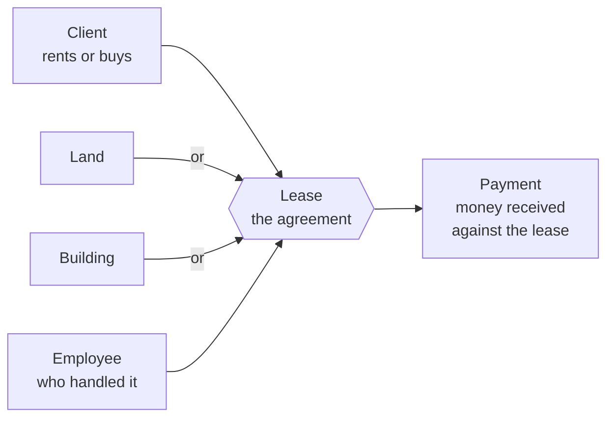
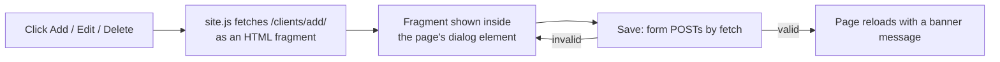
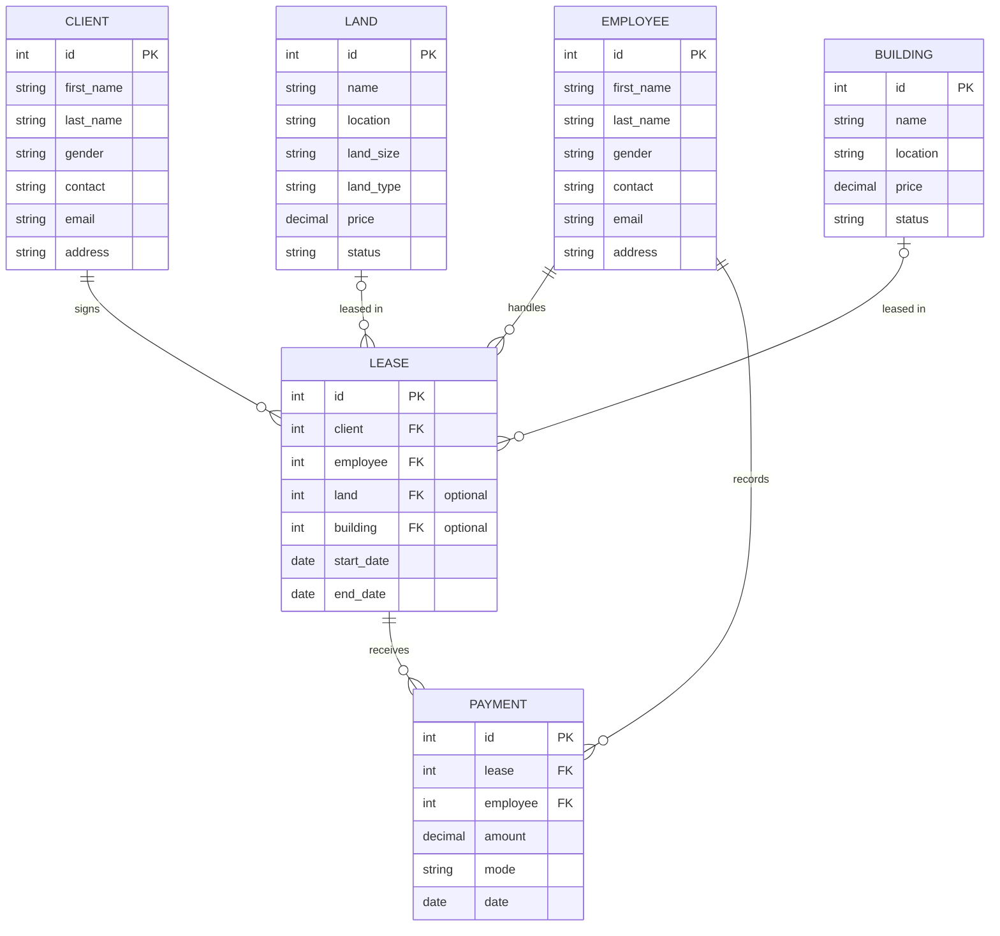
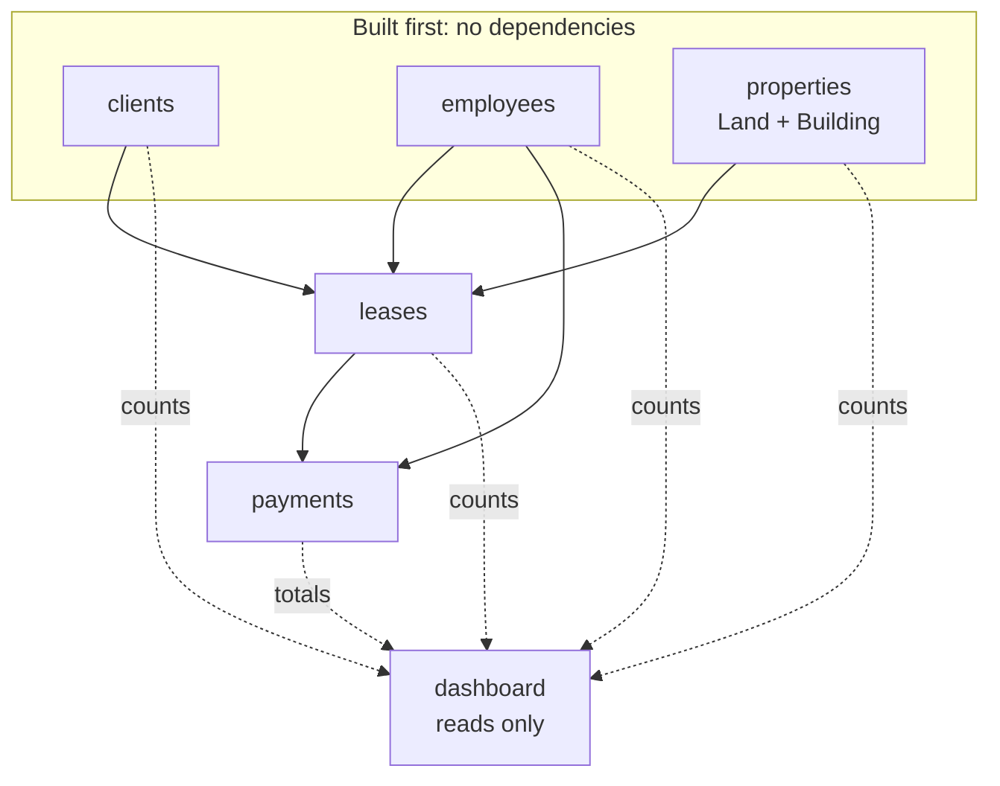
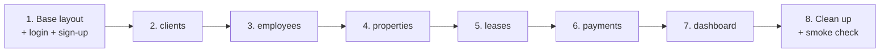
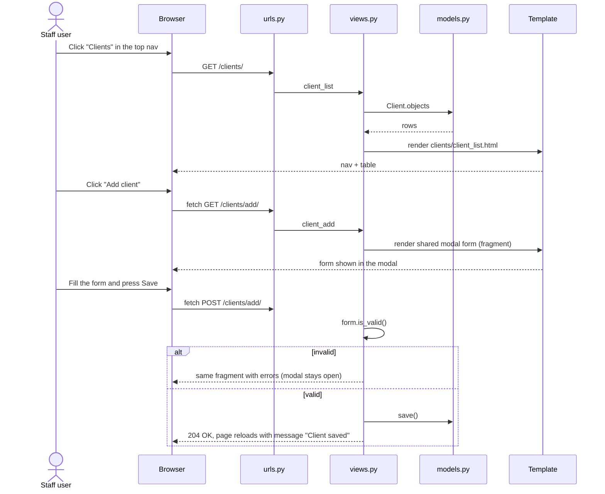

# Real Estate Management System: Redesign Plan

> Branch: `redesign/dashboard-ui` (all work and pushes stay here; nothing goes to `main`)
> Content source: `real-estate-frontend/` (the original HTML pages)
> Design: SACCO layout and feel with our own palette and icons (see section 9)
> Scope: a simple class project. **No over-engineering.**

---

## 1. The goal in one paragraph

Today the project is **one Django app** (`management`) with flat pages and a basic Bootstrap look. We will restructure
it into **one small app per feature**, a shared `base.html`, a **dashboard home page**, and a fresh visual identity
that shares **nothing** with the SACCO app. Content (clients, employees, land, buildings, leases, payments) comes
from `real-estate-frontend/`. The database is rebuilt from scratch.

### Goals

- One Django app per feature, each owning its models, forms, views, urls.
- A dashboard home page with totals and recent activity.
- A distinct look: own colors, own fonts, own icons, own layout.
- Login required everywhere except the login and sign-up pages.

### Non-goals (deliberately NOT doing)

| Not doing | Why |
|---|---|
| Charts or analytics page | Stat cards are enough. |
| REST API / JavaScript framework | Plain Django templates. The only JavaScript is one tiny hand-written file that opens and fills the modal (section 9). |
| Custom user model, roles, permissions | Django's built-in `User` is fine. |
| Tenant portal or public listings | Only staff use this system. |
| Late fees, rent schedules, invoices | A payment is just "money received". |
| Test suite beyond a smoke check | Class project. |

---

## 2. Decisions already made (by you)

| # | Decision |
|---|---|
| 1 | **Keep both `Land` and `Building` as separate tables.** |
| 2 | **Keep `/sign_up/`.** |
| 3 | **The old `db.sqlite3` is discarded.** We rebuild with fresh migrations. |
| 4 | **Everything lives on `redesign/dashboard-ui`.** Nothing is committed to `main`. |
| 5 | **Design must be totally distinct from SACCO** (colors, icons, fonts, layout, look and feel). |
| 6 | **Add, edit and delete use modals** (required). They are built and styled differently from SACCO's. |

---

## 3. Mental models

### Mental model A: "A lease is the deal, a payment is money against the deal"



A **Client** and **either a Land or a Building** meet in a **Lease**, handled by an **Employee**.
**Payments** hang off the lease. Everything else is just a list page for those things.

### Mental model B: "One app = one folder = one nav link"

Every link in the top navigation maps to one Django app (Land and Buildings share the `properties` app, so they are
two links to one folder). Point at a link and you know where its code lives.

### Mental model C: "Every list page is the same page"

```text
List page  = heading + "Add" button + table (Edit / Delete on each row)
Add / Edit = a modal containing the form (one shared template for all apps)
Delete     = a small "Are you sure?" modal (one shared template)
```

The shared modal-form and modal-confirm templates are written once and reused by every app. One small JavaScript
file opens the modal and loads the form into it.



If the form has errors, the server returns the form again with the messages and the modal simply shows it again.
If it is valid, the server answers "OK" and the page reloads to show the new row.

### Mental model D: "Dashboard only reads"

The `dashboard` app has **no models**. It counts and sums what the other apps hold.

---

## 4. The apps

We go from **1 app to 6**.

| # | App | Purpose | Model(s) | Nav link(s) | Comes from (frontend page) |
|---|---|---|---|---|---|
| 1 | `dashboard` | Home page: totals and recent activity | none | Overview | `home.html`, `index.html` |
| 2 | `clients` | People who rent or buy | `Client` | Clients | `client.html` |
| 3 | `employees` | Staff who handle deals | `Employee` | Employees | `employee.html` |
| 4 | `properties` | Things that can be leased | `Land`, `Building` | Land, Buildings | `property.html` |
| 5 | `leases` | Agreement between a client and a land or building | `Lease` | Leases | `lease.html` |
| 6 | `payments` | Money received against a lease | `Payment` | Payments | `payment.html` |

Plus the project folder `realestate/` (settings, root urls) and a small `core` folder for shared helpers.
Login, logout and sign-up are views in `core` (Django's `LoginView` / `LogoutView` plus the existing sign-up view),
so they need no app of their own.

### Why these boundaries

| Decision | Reason |
|---|---|
| `clients` and `employees` are separate although the fields match | Each is tiny, matches the original pages, and two classmates can work in parallel. |
| `Land` and `Building` share one app | They are the same kind of thing and both feed the lease. |
| `payments` is its own app | The original frontend has its own Payment page. |
| `dashboard` has no models | No duplicated data. |

---

## 5. Data model

### Relationship diagram



### Fields table

| Model | Fields | Notes |
|---|---|---|
| **Client** | first_name, last_name, gender, contact, email, address | Same as today, bugs fixed (below). |
| **Employee** | first_name, last_name, gender, contact, email, address | Same as today, bugs fixed. |
| **Land** | name, location, land_size, land_type, price, status (Available / Taken) | `price` added (the original frontend page has a selling price). |
| **Building** | name, location, price, status (Available / Taken) | `price` added. |
| **Lease** | client, employee, land *or* building, start_date, end_date | **New:** the property link and dates. Today a lease cannot say *what* was leased. |
| **Payment** | lease, employee, amount, mode (Cash / Cheque / Bank Transfer), date | **Changed:** one link to a lease replaces the old four (client, land, building, employee). |

### The one slightly tricky rule: "land OR building"

`Lease` has two optional links, `land` and `building`. The lease form's `clean()` method checks that **exactly one**
is chosen and shows an error otherwise. That single check is all the extra logic this needs. Marking a land or
building as "Taken" when a lease is saved is **not** automatic (the user edits the status). Keeping it manual avoids
extra code.

### Existing bugs to fix while we are here

| Where | Problem | Fix |
|---|---|---|
| `Client` / `Employee` `GENDER_OPTIONS` | Both options use the value `"M"`, so Female cannot be saved or told apart | `("M", "Male"), ("F", "Female")` |
| `email = CharField()` | No `max_length` | `EmailField()` |
| `Payment.amount_paid` | Stored as text, so totals are impossible | `DecimalField` |
| `Payment` needs a land **and** a building | A payment about only one cannot be saved | Link to a lease |
| `contact` max 10 | Too short for `+256...` numbers | Raise to 15 |
| `Land` / `Building` status | Option labels are `TAKEN` / `NOT TAKEN` | Use `Taken` / `Available` for clarity |

---

## 6. How the apps relate



Solid arrows are "points to" (foreign keys). Dotted arrows are "the dashboard reads from".

### Build order (follows the arrows)



`clients`, `employees` and `properties` are near-copies of one another, so once `clients` works the next ones are quick.

---

## 7. How a request flows



---

## 8. URLs

Each app has its own `urls.py` with the same four routes. Add, edit and delete URLs return a small HTML fragment
for the modal (GET) and handle the submit (POST); they are not full pages.

| Section | List | Add | Edit | Delete |
|---|---|---|---|---|
| Clients | `/clients/` | `/clients/add/` | `/clients/<id>/edit/` | `/clients/<id>/delete/` |
| Employees | `/employees/` | `/employees/add/` | `/employees/<id>/edit/` | `/employees/<id>/delete/` |
| Land | `/land/` | `/land/add/` | `/land/<id>/edit/` | `/land/<id>/delete/` |
| Buildings | `/buildings/` | `/buildings/add/` | `/buildings/<id>/edit/` | `/buildings/<id>/delete/` |
| Leases | `/leases/` | `/leases/add/` | `/leases/<id>/edit/` | `/leases/<id>/delete/` |
| Payments | `/payments/` | `/payments/add/` | `/payments/<id>/edit/` | `/payments/<id>/delete/` |

| Other URL | View | Notes |
|---|---|---|
| `/` | `dashboard.views.index` | Login required |
| `/login/`, `/logout/` | Django `LoginView` / `LogoutView` | Existing login template, restyled |
| `/sign_up/` | existing sign-up view | Kept. Public, linked from the login page. |
| `/admin/` | Django admin | Linked in the footer of the page |

---

## 9. Design: SACCO's look and feel, our own palette and icons

> **Update (supersedes the earlier "totally distinct" direction).** The layout and feel now follow the SACCO
> app: a floating left sidebar, white cards, raised icon tiles on the stat cards, uppercase table headings,
> modals and toasts. Only two things are different: the **palette** and the **icon set**.
> The stylesheet is still written fresh for this project.

### Palette (given, from the reference image)

| Token | Hex | Used for |
|---|---|---|
| `--espresso` | `#291C0E` | sidebar, text, login background |
| `--umber` | `#6E473B` | secondary tiles, muted text (darkened where contrast needs it) |
| `--tan` | `#A78D78` | primary buttons, current page in the sidebar, "Available" tags |
| `--stone` | `#BEB5A9` | lines and borders |
| `--cream` | `#E1D4C2` | page background |

Everything else is mixed from these five: a near-white card tint and hover shades.
**One exception:** a muted red `#b3392f` for delete buttons and error messages only, so destructive actions
stay recognisable.

### What is the same as SACCO

Floating rail sidebar with brand, nav list, Django Admin link and log out; top bar with page title and one primary
"Add" button; list pages are one card with a table with sticky edit/delete icons; stat cards with
raised icon tiles; "Recent" tables on the dashboard; modal forms and confirm modals; toasts for messages;
login page on a deep-teal background; the rail collapses to a top bar on phones.

### What is different

| Aspect | SACCO | Estate Desk |
|---|---|---|
| Colours | navy, beige, amber, rust | the five brown and cream colours above |
| Icons | Lucide | **Phosphor Icons** (regular weight, CDN web font) |
| Logo | PNG | small inline SVG house mark |
| Sidebar items | Members, Staff, Accounts... | Overview, Clients, Employees, Land, Buildings, Leases, Payments |
| Analytics page | yes | no (stat cards and recent tables only) |
| Pagination and search | yes | no |

### Implementation notes

| Piece | Approach |
|---|---|
| CSS | One hand-written `static/css/site.css`, tokens as CSS variables |
| Fonts | All three are used, each with one job: **Nunito** (playful) for page titles, brand, card and modal titles; **Source Sans 3** (humanist) for body text, navigation, buttons and forms; **IBM Plex Sans** (business) for tables, numbers and tags. All from Google Fonts. |
| Icons | Phosphor via CDN `<link>`, no download |
| JavaScript | `static/js/site.js` (about 25 lines): open the `<dialog>`, fetch the fragment, submit by fetch, reload on success |

---

## 10. Target file layout

```text
RealEstate-Management-System/
├── manage.py
├── docs/redesign-plan.md           <- this file
├── realestate/                     (settings, root urls)
├── core/                           (login/sign-up views, money filter, search helper)
├── clients/      models.py forms.py views.py urls.py admin.py
├── employees/    (same files)
├── properties/   (Land and Building in one models.py / forms.py / views.py / urls.py)
├── leases/       (same files)
├── payments/     (same files)
├── dashboard/    views.py
├── templates/
│   ├── base.html                   (top nav, banner, footer, the one <dialog>)
│   ├── partials/_nav.html  _table_actions.html
│   ├── shared/modal_form.html  modal_confirm.html
│   ├── registration/login.html  sign_up.html
│   ├── dashboard/index.html
│   └── clients/client_list.html    (one folder per app, one list page each)
└── static/  css/site.css  js/site.js
```

---

## 11. Moving from today's code

| Today | After |
|---|---|
| `management/` app with all models | Split into the 5 model apps. `management/` is deleted at the end. |
| `management/templates/*.html` (Bootstrap + crispy) | Replaced by `templates/<app>/<app>_list.html` plus the two shared modal templates. |
| `real-estate-frontend/*.html` | Reference for fields only. Left untouched. |
| `db.sqlite3` | **Deleted**, then `makemigrations` and `migrate`. Old migrations are regenerated. |
| Names like `client_page` | `client_list`, `client_add`, `client_edit`, `client_delete` |
| `crispy_forms`, `crispy_bootstrap4` | Removed from `INSTALLED_APPS` and `requirements.txt` |

---

## 12. Git workflow

| Rule | Detail |
|---|---|
| Branch | `redesign/dashboard-ui` only |
| Never | Commit to, merge into, or push `main` |
| Commits | One small commit per step in the checklist below |
| Push | `git push -u origin redesign/dashboard-ui` (only when you say so) |
| Review | Merging into `main` is a separate decision you make later, outside this plan |

---

## 13. Step-by-step checklist

| Step | Task | Done when |
|---|---|---|
| 0 | Branch `redesign/dashboard-ui` | Created |
| 1 | `site.css`, `site.js`, `base.html` with the dialog, nav, shared modal templates, login and sign-up restyled | Login and sign-up render in the new style |
| 2 | `clients` app: model, form, views, urls, list page | Add, edit, delete in modals all work |
| 3 | `employees` app (copy of step 2) | Same |
| 4 | `properties` app: Land and Building | Both lists work |
| 5 | `leases` app with the "land or building" check | A lease saves only with exactly one of them |
| 6 | `payments` app (dropdown of leases) | A payment saves |
| 7 | `dashboard` with six cards and two recent tables | Numbers match the lists |
| 8 | Remove `management/`, crispy forms, old DB. Update `requirements.txt` and README. | `runserver` works from a clean clone |
| 9 | Smoke check: click every nav link, add / edit / delete one record in each app | No errors |

---

## 14. Calls I made (please check)

| # | Call | Alternative |
|---|---|---|
| 1 | Lease links to land **or** building through two optional links plus one `clean()` check | A generic relation (more complex, not worth it) |
| 2 | Added `price` to `Land` and `Building` | Leave prices out |
| 3 | Land and Building are marked Taken **manually** | Auto-update on lease save |
| 4 | Modals (your requirement) built on native `<dialog>` plus one small fresh JS file, styled with a green title bar so they do not resemble SACCO's | A JS library such as Bootstrap modals (more weight, more resemblance to generic templates) |
| 5 | Forest green, brick and gold palette with Lora and Inter | Any other palette, as long as it stays unlike SACCO |
| 6 | Working name "Estate Desk" | Your own name |
| 7 | Money is shown as UGX with a small filter written in `core` | Another currency |
