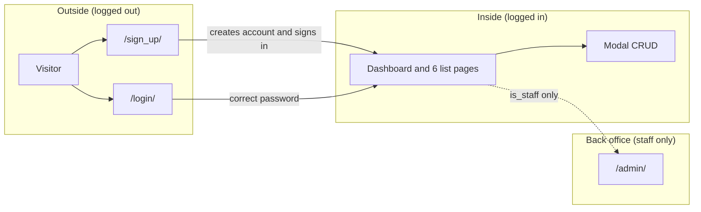
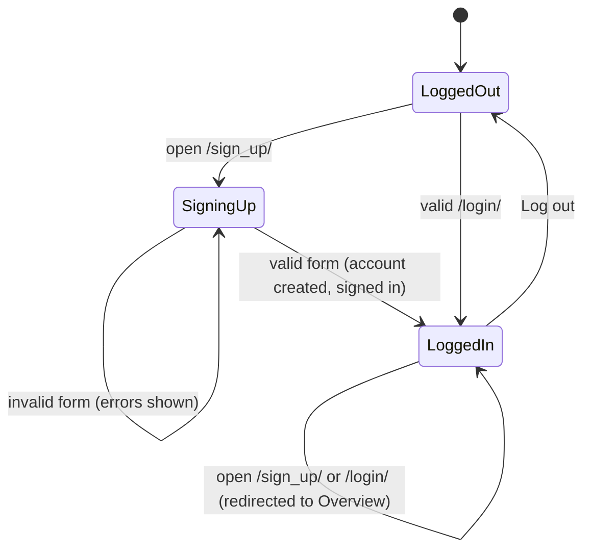
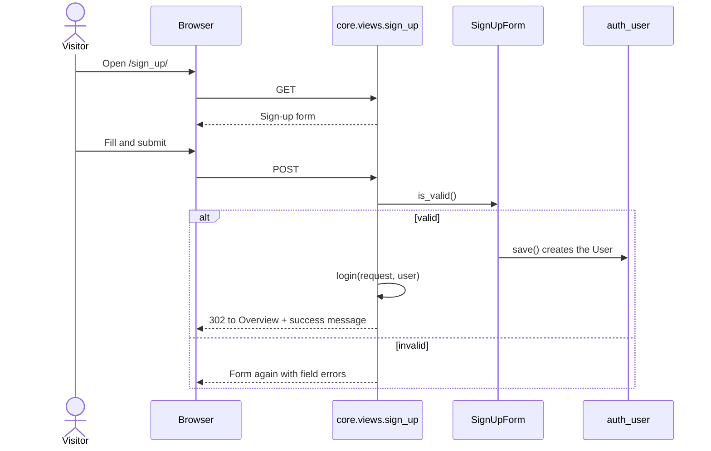
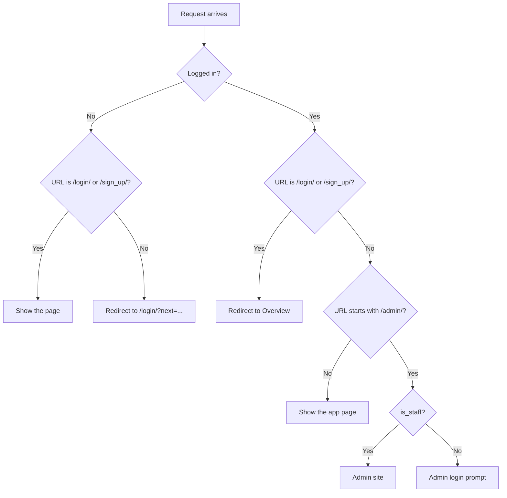
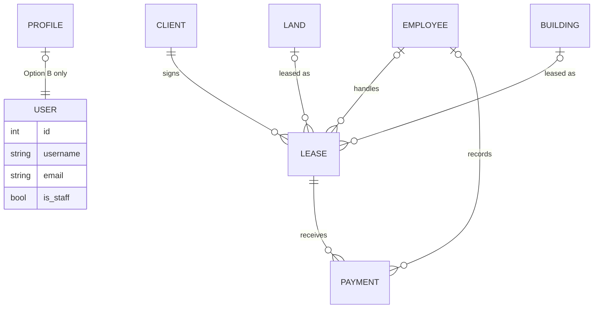
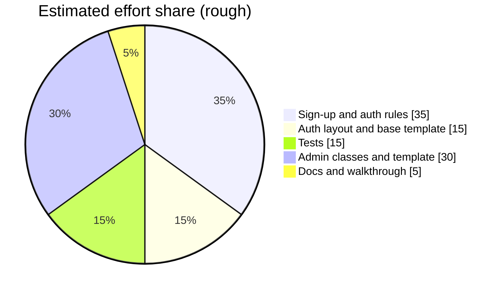

# Sign-up and marking criteria plan

StStatus: **built** (steps 1, 2, 3, 6). The current state of the app is described in the top-level `README.md`; sections 2 and 4 below describe the situation before this work. Question 3 was answered: the lecturer's "admin template" means the dashboard, so steps 4 and 5 (admin customisation) were dropped.
 1. Why this plan exists

The lecturer marks the project on a fixed list, and wants to **see sign-up working** because the system is meant to be like GitHub: an internal-style tool that people come to and register for.

| What the lecturer marks | Pre-marked? |
|---|---|
| HTML, CSS, JavaScript | Yes (front-end mock build), ignore |
| Django Pages | No |
| Models | No |
| CRUD | No |
| Base template | No |
| Django Auth | No |
| Admin template | No |

The one hard requirement about sign-up: **it must exist, be easy to find, and must not appear for a user who is logged in.**

## 2. Where we are today

Checked against the code on `main`.

| Criterion | What exists now | Gap |
|---|---|---|
| Django Pages | Overview plus one list page per entity (6 apps), login, sign-up | No gap in page count. Auth pages are plain |
| Models | `Client`, `Employee`, `Land`, `Building`, `Lease`, `Payment` with FKs and a `clean()` check on `Lease` | The `User` model is not related to anything we own |
| CRUD | Add, edit, delete through modals for all 6 entities, explicit function views | None |
| Base template | `templates/base.html` with blocks (`title`, `page_title`, `actions`, `content`, `shell`), partials for sidebar, fields, table actions | Login and sign-up override the whole `shell` block, so inheritance is less visible than it could be |
| Django Auth | `LoginView`, `LogoutView`, `UserCreationForm` sign-up, `@login_required` on 31 view functions | **Sign-up is reachable when logged in. It does not log the new user in. It collects no name or email. Login is reachable when logged in too** |
| Admin template | Every model is registered with a bare `admin.site.register(Model)` | **No customisation at all. Default Django admin look** |

Summary: CRUD and Models are solid. **Django Auth and Admin template are the weak spots**, and sign-up is the piece the lecturer is looking for.

## 3. Mental model

Think of the app as a building with two doors.

Rules in one line each:

1. **Outside pages** (`/login/`, `/sign_up/`) are for logged-out visitors only.
2. **Inside pages** need a login. Everyone who signs up gets in.
3. **Back office** (`/admin/`) needs `is_staff`, which only a superuser can grant.

## 4. Sign-up: what we will build

### 4.1 Behaviour

| Situation | Today | Planned |
|---|---|---|
| Logged-out visitor opens `/login/` | Login form, small "Create an account" link | Login form, with a clear **Log in / Sign up** switch at the top of the card and the link kept below |
| Logged-out visitor opens `/sign_up/` | Username and two passwords | Username, first name, last name, email, two passwords |
| Submit valid sign-up | Redirects to login with a message | **Creates the user, logs them in, goes to the Overview** with a welcome toast |
| Submit invalid sign-up | Errors in the form | Same, errors shown per field |
| Logged-in user opens `/sign_up/` | Sign-up form is shown | **Redirected to the Overview** |
| Logged-in user opens `/login/` | Login form is shown | **Redirected to the Overview** |
| Sign-up link inside the app (sidebar, top bar) | None | **None, by design** |
| Logged-in user sees "Create an account" anywhere | No | **No** |

### 4.2 Visitor states

### 4.3 Request flow for a new sign-up

### 4.4 Access rules per URL

### 4.5 Where the lecturer sees it

| Place | Logged out | Logged in |
|---|---|---|
| `/login/` card header switch | Visible | Page not reachable |
| `/login/` footer link | Visible | Page not reachable |
| `/sign_up/` | Visible | Redirected away |
| Sidebar and pages inside the app | n/a | Not present |

## 5. The other marked criteria

### 5.1 Django Auth (strengthened)

| Feature | Status | How it is shown |
|---|---|---|
| Login and logout | Done | Standard Django views |
| Sign-up | Needs work | Section 4 |
| Logged-in-only pages | Done | `@login_required`, `LOGIN_URL` in settings |
| Logged-out-only pages | New | Redirect logged-in users away from login and sign-up |
| Password rules | Free | Django validators already run in `UserCreationForm` |
| Staff vs normal user | Done | Django Admin link in the sidebar only for `is_staff` |
| Logged-in name and logout button | Done | Bottom of the sidebar |

Not planned (keeps it simple): password reset by email, email verification, social login.

### 5.2 Models

Two options. **Recommended: Option A.**

| | Option A (recommended) | Option B |
|---|---|---|
| Change | None. Users stay as Django `User` only | Add a `Profile` model, one-to-one with `User` (phone, role), created at sign-up |
| Effort | Zero | Small to medium: model, migration, signal or form save, admin, template |
| Marking value | Already six real models with relations | Shows `User` linked to our own model |
| Risk | Lecturer may want to see `User` used | More code to explain and test |

`USER` has no line to the business tables in Option A. That is intentional: staff log in, clients are records.

### 5.3 CRUD

No change. Already six entities with add, edit and delete modals. During the demo, a freshly signed-up user performs one full add, edit and delete to prove sign-up leads to a usable system.

### 5.4 Base template

| Change | Why |
|---|---|
| Add `templates/auth_base.html` that extends `base.html` and holds the centred card, logo and footer link | Login and sign-up stop duplicating markup, and inheritance now has two levels (`base`, then `auth_base`, then page) |
| Keep `base.html` blocks as they are | Nothing else needs to move |

### 5.5 Admin template

"Admin template" is read here as the **customised Django admin**. If the lecturer meant something else (for example the admin-only part of our own UI), tell us in question 3.

| Change | Detail |
|---|---|
| `ModelAdmin` per model | `list_display`, `list_filter`, and `search_fields` where it helps (admin only, the app UI keeps no search) |
| Branding | `site_header`, `site_title`, `index_title` set to "Estate Desk" |
| Template override | `templates/admin/base_site.html` extends the Django one and loads `static/css/admin.css` |
| Colours | `admin.css` sets Django's admin colour variables to the brown palette. Solid colours only, no gradients |
| Users in admin | Default `User` admin kept, so a superuser can promote someone to `is_staff` |

## 6. Files that change

| File | Change |
|---|---|
| `core/forms.py` (new) | `SignUpForm(UserCreationForm)` with first name, last name, email |
| `core/views.py` | `sign_up` redirects logged-in users, logs the new user in, welcome message |
| `realestate/urls.py` | `LoginView.as_view(redirect_authenticated_user=True)` |
| `templates/auth_base.html` (new) | Shared auth card |
| `templates/registration/login.html` | Extends `auth_base`, adds Log in / Sign up switch |
| `templates/registration/sign_up.html` | Extends `auth_base`, new fields |
| `static/css/site.css` | Styles for the switch, flat colours only |
| `*/admin.py` (6 files) | `ModelAdmin` classes |
| `core/admin.py` (new) | Site header and titles |
| `templates/admin/base_site.html` (new) | Admin override |
| `static/css/admin.css` (new) | Admin palette |
| `core/tests.py` | Sign-up and visibility tests |
| `README.md` | Short note on sign-up and admin |

## 7. Build order and effort

Effort figures are rough estimates, not measurements.

| Step | Work | Size | Commit message idea |
|---|---|---|---|
| 1 | `SignUpForm`, updated `sign_up` view, login redirect rules | S | Sign up collects name and email, signs the user in |
| 2 | `auth_base.html` and the Log in / Sign up switch | S | Share one auth layout between login and sign-up |
| 3 | Tests for the access rules | S | Test sign-up and logged-in redirects |
| 4 | `ModelAdmin` classes and site titles | S | Customise the admin for every model |
| 5 | Admin template override and palette | M | Brand the Django admin |
| 6 | README and manual walkthrough | S | Document sign-up and admin |

## 8. Test plan

Automated (Django `TestCase`):

| Test | Expected |
|---|---|
| Logged-out GET `/sign_up/` | 200, form shown |
| Valid POST to `/sign_up/` | User exists, response redirects to Overview, user is logged in |
| Password mismatch POST | 200, no user created |
| Duplicate username POST | 200, error shown |
| Logged-in GET `/sign_up/` | 302 to Overview |
| Logged-in GET `/login/` | 302 to Overview |
| Logged-out GET `/clients/` | 302 to `/login/?next=/clients/` |
| Normal user GET `/admin/` | Redirected to admin login |
| Logged-in Overview HTML | Does not contain "sign_up" |

Manual, in the browser: sign up, land on Overview, add a client, edit it, delete it, log out, check the sign-up page is visible again.

## 9. Marking demo script

A route the lecturer can follow in five minutes.

| Step | What to show | Criterion it proves |
|---|---|---|
| 1 | Open `/` logged out, get sent to login, point at the Sign up switch | Django Auth |
| 2 | Create an account on `/sign_up/` | Django Auth, Django Pages |
| 3 | Land on the Overview, open `/sign_up/` by hand, get bounced back | Django Auth |
| 4 | Add, edit, delete a client in the modal | CRUD, Models |
| 5 | Open any list page and the login page source, show `extends` | Base template |
| 6 | Log in as admin, open Django Admin, show custom list columns and branding | Admin template |
| 7 | Show `core/tests.py` passing | Quality of Auth work |

## 10. Decisions we need from you

| # | Question | Recommendation |
|---|---|---|
| 1 | After sign-up, sign the user in straight away (like GitHub), or send them to the login page? | Sign in straight away |
| 2 | Should everyone who signs up get full add, edit and delete rights, or read-only until someone approves them? | Full rights, because it is an internal-style class demo. Read-only or approval is a possible extra if the lecturer asks |
| 3 | By "admin template", does the lecturer mean the customised Django admin, or something inside our own app? | Customised Django admin, as planned in 5.5 |

Optional extras we are **not** building unless you ask: the `Profile` model (5.2 Option B), a public landing page for logged-out visitors, approval of new accounts, password reset by email.

## 11. Risks

| Risk | Effect | Mitigation |
|---|---|---|
| Open sign-up gives full access to all demo data | Anyone who finds the URL can edit data | Acceptable for a class demo. Keep the data demo-only. Section 10 question 2 covers tightening |
| Real names in git history | The defense schedule PDF is still in the history of `main` (commit `5c00f2a`) | Separate decision about rewriting history. Not part of this plan |
| Admin override breaks after a Django upgrade | Admin looks default | Only variables and one block are overridden, so the surface is small |
